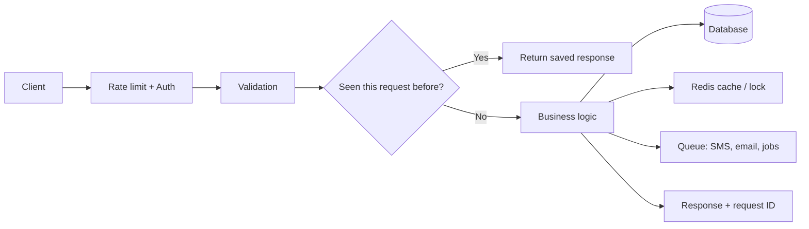

 

---

## 👨‍💻 About me

I'm a **full-stack software engineer from Sri Lanka 🇱🇰 who leans towards the backend**. I'm happiest designing clean architecture, building fast and secure APIs, and making systems stay reliable under real-world conditions, while still shipping polished interfaces on top. I also explore how AI agents can make developers more effective.

> *"Make it work, make it right, make it fast."*

---

## 🎯 What drives me

| | |
| --- | --- |
| 🏗️ **Solid architecture** | Clean, modular code that stays easy to change |
| ⚡ **Performance** | Fast responses and smart caching |
| 🔐 **Security & reliability** | Systems that stay safe and recover gracefully |
| ☁️ **Cloud** | Scalable, automated deployments |
| 🤖 **Agentic AI** | Governed, tested AI that works with people |
| 📚 **Learning** | Pursuing an MSc in Artificial Intelligence |

---

## 🧰 Tech I work with

**Languages**

    

**Backend & Frontend**

     

**Databases**

    

**Cloud & DevOps**

      

**AI & Agents**

   

---

## ⚙️ Under the hood: engineering I enjoy

<b>🔐 Secure, predictable APIs</b>

- Layered architecture that separates request handling, business rules and data access
- Token-based auth with refresh, role-based access and rate limits against abuse
- Consistent validation and one standard result format across services

<b>🔁 Reliability &amp; background work</b>

- **Idempotent writes:** a repeated request (like a double-clicked payment) is answered from a saved response instead of running twice
- Redis for caching and locks to prevent duplicate work
- Queues with retries, timeouts and failure handling; schedulers for recurring jobs and bulk SMS/email delivery
- Request-ID tracing that links every call to its structured error log

<b>🖥️ Concurrency &amp; hardware</b>

- Multithreaded desktop apps where the UI never freezes: background workers hand results back to the screen safely
- Print queues, locks and transactions that keep shared resources consistent
- Talking directly to receipt printers and cash drawers, with barcode generation

<b>📡 Offline-first systems</b>

- Connectivity watchers that detect online/offline state in seconds
- Store-and-forward queues: work is saved locally, then synced in order with the original time and user
- Salted password hashes for offline sign-in, audit logs written in the same transaction, atomic backups and safe schema migrations

<b>☁️ Cloud &amp; delivery</b>

- AWS, containers and Kubernetes-style deployments, CI/CD pipelines, reproducible Docker environments
- Signed installers and verified auto-updates (SHA-256 integrity checks)

<b>🤖 Agentic engineering</b>

- MCP servers and reusable agent skills so AI coding agents follow approved specifications
- Golden sets as both spec and regression gate, with human approvals, guardrails and evaluation

---

## 🌱 Currently exploring

    

---

## 🤝 Let's connect

I'm always happy to talk about backend design, cloud, AI agents, or new opportunities.

📍 Colombo, Sri Lanka &nbsp;•&nbsp; 🌐 [pamaljithranasinghe.dev](https://pamaljithranasinghe.dev) &nbsp;•&nbsp; 📧 [pamalranasinghe464@gmail.com](mailto:pamalranasinghe464@gmail.com)

